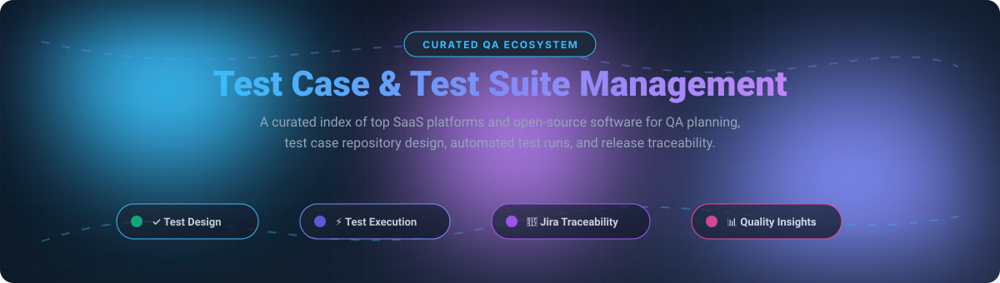

# ⚡ Awesome Test Case & Test Suite Management 🚀

  <b>A comprehensive, curated collection of top SaaS test management tools and open-source test case management software (TCMS) for QA engineers, SDETs, and engineering leaders to organize test plans, orchestrate automated test runs, and track full lifecycle traceability.</b>

⭐ **Star this repository if you find it valuable for your QA workflows!** ⭐

---

## 📑 Table of Contents

- [🌐 Sector Overview & Market Dynamics](#-sector-overview--market-dynamics)
- [🟦 SaaS / Hosted Platforms](#-saas--hosted-platforms)
  - [SaaS Platforms Comparison Table](#saas-platforms-comparison-table)
  - [Detailed SaaS Profiles](#detailed-saas-profiles)
- [🟩 Open-Source Software](#-open-source-software)
  - [Open-Source Solutions Comparison Table](#open-source-solutions-comparison-table)
  - [Detailed Open-Source Profiles](#detailed-open-source-profiles)
- [📊 Feature Matrix at a Glance](#-feature-matrix-at-a-glance)
- [📈 Star History](#-star-history)
- [💖 Support & Sponsorship](#-support--sponsorship)
- [🤝 Contributing](#-contributing)
- [📄 License](#-license)

---

## 🌐 Sector Overview & Market Dynamics

The global **test management software market** is currently estimated at **$1.3B – $1.7B** (expanding at an ~11–12% CAGR within the broader $55B+ software testing and QA ecosystem). The sector is **moderately fragmented** rather than winner-take-all: entrenched legacy players and private equity roll-ups (such as Idera and SmartBear) share substantial enterprise market share with cloud-first challengers (BrowserStack, Qase, Testmo) and native Jira marketplace plugins, while open-source solutions maintain a resilient footprint among privacy-conscious and budget-constrained engineering teams.

---

## 🟦 SaaS / Hosted Platforms

Modern commercial, cloud-hosted Test Case & Test Suite Management platforms provide deep issue-tracker integrations, automation ingestion pipelines, and AI-accelerated test lifecycle management.

### SaaS Platforms Comparison Table

> *Sorted in descending order by estimated company valuation / scale.*

| Product | Company Valuation / Revenue Scale | Starting Tier Price | Free Tier / Free Trial Limits | Key Specialization |
| :--- | :--- | :--- | :--- | :--- |
| **[BrowserStack Test Management](https://www.browserstack.com/test-management)** | **$4.0B Valuation** (~$230M ARR) | **$19/user/month** (Pro plan, billed annually) | **Free Forever Plan**: Up to 5 users, unlimited test cases, unlimited projects, 10 GB storage, 30-day run history | Real-device cloud execution & AI-assisted QA workflows |
| **[TestRail](https://www.testrail.com/)** | **~$3.0B Parent Valuation** (Idera; ~$10M–$15M product ARR) | **$22/user/month** (Essentials plan for up to 5 users, billed annually) | **30-Day Free Trial**: Full access to Professional or Enterprise features; no permanent free tier | Enterprise standalone test repository & compliance audits |
| **[Xray](https://www.getxray.app/)** | **~$3.0B Parent Valuation** (Idera / Xblend; ~$20M+ ARR) | **$10/month flat rate** (Cloud for up to 10 Jira users) | **30-Day Free Trial**: Full Jira Cloud marketplace evaluation; no permanent free tier | Native Jira requirement traceability & release audits |
| **[Zephyr Scale](https://smartbear.com/test-management/zephyr-scale/)** | **~$2.0B Valuation** (SmartBear; >$500M total company revenue) | **$10/month flat rate** (Standard Cloud for up to 10 Jira users) | **30-Day Free Trial**: Available via Atlassian Marketplace; no permanent free tier | Deep Jira-native hierarchical test libraries & 70+ reports |
| **[SpiraTest](https://www.inflectra.com/spiratest/)** | **~$13M Revenue Run-rate** (Inflectra, bootstrapped) | **$43.66/user/month** (Concurrent licensing; $130.99/mo for 3 users min) | **30-Day Free Trial**: Full access to all SpiraTest ALM capabilities; no permanent free tier | Concurrent user licensing, integrated ALM & requirements |
| **[Qase](https://qase.io/)** | **~$7.7M Funding** (~$5M ARR) | **$20/user/month** (Teams plan, billed annually) | **Free Forever Plan**: Up to 4 full users, 2 active test runs, 5,000 API-submitted results/month | Modern REST API-first TestOps & seamless CI/CD ingestion |
| **[PractiTest](https://www.practitest.com/)** | **Bootstrapped** (~$2M–$5M estimated revenue) | **$49/user/month** (Team plan, billed annually, min 5 users) | **14-Day Free Trial**: Complete access across modules and analytics; no permanent free tier | End-to-end QA process visibility & cross-project views |
| **[Testmo](https://www.testmo.com/)** | **Bootstrapped / Indie** (Profitable scale-up) | **$99/month flat rate** (Team plan, covers up to 10 users) | **21-Day Free Trial**: Full platform access without credit card; no permanent free tier | Ultra-fast unified UI for manual, exploratory, and automation |

---

### Detailed SaaS Profiles

#### 🔹 [BrowserStack Test Management](https://www.browserstack.com/test-management)
- **Focus:** AI-accelerated test suite management integrated into the BrowserStack real-device testing cloud.
- **Highlights:** Reusable test step templates, rich-text markdown specifications, release-linked planning, and instant cross-browser execution on 3,000+ real devices.
- **Best For:** Engineering teams looking to combine manual test orchestration with real-device cloud automation.

#### 🔹 [TestRail](https://www.testrail.com/)
- **Focus:** Dedicated standalone test case and test execution repository with enterprise audit logging.
- **Highlights:** Milestones, structured test runs, historical results aggregation, multi-project dashboards, and rich REST API support.
- **Best For:** QA organizations requiring an independent test management platform separated from standard developer issue trackers.

#### 🔹 [Xray](https://www.getxray.app/)
- **Focus:** Jira-native test management that treats tests as standard Jira issue types.
- **Highlights:** Unbroken requirements-to-defect traceability, automated test ingestion (Cucumber, JUnit, TestNG), and auditable release sign-offs.
- **Best For:** Atlassian-first teams needing strict regulatory and audit traceability directly inside Jira.

#### 🔹 [Zephyr Scale](https://smartbear.com/test-management/zephyr-scale/)
- **Focus:** Jira-native test management engineered for complex, high-volume testing programs.
- **Highlights:** Hierarchical folders, parameterized testing, reusable shared test steps, versioning, and over 70 cross-project quality analytics reports.
- **Best For:** Large enterprises standardizing on Jira who require structured test library governance.

#### 🔹 [SpiraTest](https://www.inflectra.com/spiratest/)
- **Focus:** Integrated Application Lifecycle Management (ALM) combining requirements, tests, and defects.
- **Highlights:** Concurrent user seat pricing model, built-in exploratory test capture, and extensive third-party tool integrations.
- **Best For:** Organizations seeking cost-effective concurrent licensing across QA and product stakeholders.

#### 🔹 [Qase](https://qase.io/)
- **Focus:** Modern TestOps platform optimized for developer and SDET automation workflows.
- **Highlights:** First-class REST API, query language filtering (QQL), generous free tier, and instant integrations with Jira, GitHub, GitLab, and Linear.
- **Best For:** Fast-moving engineering teams prioritizing API-driven test result reporting from automated CI/CD pipelines.

#### 🔹 [PractiTest](https://www.practitest.com/)
- **Focus:** Holistic QA management offering end-to-end quality process orchestration.
- **Highlights:** Customizable custom fields, reusable filter views, cross-project dashboards, and bidirectional bug tracker synchronization.
- **Best For:** Established testing teams needing centralized governance across diverse manual and automated testing initiatives.

#### 🔹 [Testmo](https://www.testmo.com/)
- **Focus:** High-speed unified test management built for manual, exploratory, and automated test results.
- **Highlights:** Blazing fast modern user experience, flat team-tier pricing, seamless CLI submission for test results, and robust GitHub/Jira integrations.
- **Best For:** Modern software teams tired of slow, legacy QA platforms who want a unified dashboard.

---

## 🟩 Open-Source Software

Self-hosted, community-driven Test Case and Test Suite Management software offering data sovereignty, compliance control, and zero vendor lock-in.

### Open-Source Solutions Comparison Table

> *Sorted in descending order by GitHub Star counts.*

| Project | GitHub Stars | Tech Stack | License | Architecture & Integration |
| :--- | :---: | :--- | :--- | :--- |
| **[TestLink](https://github.com/TestLinkOpenSourceTRMS/testlink-code)** |  | PHP / MySQL / Apache | GPL-2.0 | Longstanding web-based TCMS, requirements management, Bugzilla/Mantis/Jira connectors |
| **[Kiwi TCMS](https://github.com/kiwitcms/Kiwi)** |  | Python / Django / PostgreSQL | GPL-3.0 | Modern IEEE 829-aligned test management, 1-click bug reporting, containerized Docker deployment |
| **[Nitrate](https://github.com/Nitrate/Nitrate)** |  | Python / Django / MariaDB | GPL-2.0 | Enterprise test plan and run management originally developed by Red Hat |
| **[QuAck](https://github.com/greatbit/quack)** |  | Java / Docker / React | Apache-2.0 | Dynamic attribute-based grouping rather than rigid trees; flexible REST API |
| **[QaraTMS](https://github.com/a13xh7/QaraTMS)** |  | PHP / Laravel / MySQL | MIT | Clean test suite and test plan organizer with defect linking and markdown documentation |
| **[UnitTCMS](https://github.com/kimatata/unittcms)** |  | Python / Docker / SQLite/PG | AGPL-3.0 | Modern lightweight test case management engineered for turnkey Docker self-hosting |
| **[TestPlanIt](https://github.com/TestPlanIt/testplanit)** |  | TypeScript / PostgreSQL / Docker | AGPL-3.0 | Next-gen agile-first test management platform built with modern web technologies |
| **[OpenTMI](https://github.com/OpenTMI/opentmi)** |  | Node.js / MongoDB | MIT | Test Management Infrastructure for CI/CD test results, device logs, and hardware testbeds |
| **[Tesbo Test Manager](https://github.com/QAbleHQ/Tesbo-Test-Manager)** |  | Node.js / React / Docker | MIT | Open-source test case management designed to organize test cycles and integrate AI workflows |
| **[ThoroTest](https://github.com/ecamuto/thorotest)** |  | TypeScript / Docker | MIT | Manual & automated suites, requirements traceability, Jira integration, and BYOK AI test creation |
| **[Squash TM](https://gitlab.com/HenixDevelopment/open-source/squash)** | *GitLab Core* | Java / PostgreSQL / MySQL | LGPL-3.0 (Open-Core) | Requirements-to-test governance, Squash AUTOM test execution plugins, enterprise Jira sync |

---

### Detailed Open-Source Profiles

#### 🟢 [TestLink](https://github.com/TestLinkOpenSourceTRMS/testlink-code)
- **Overview:** The pioneer web-based test management platform with millions of installs over two decades.
- **Capabilities:** Hierarchical test suites, requirements tracking, execution assignment by build/milestone, and export formats to Word/Excel.
- **Considerations:** Classic PHP architecture; best for teams seeking proven zero-license-cost utility.

#### 🟢 [Kiwi TCMS](https://github.com/kiwitcms/Kiwi)
- **Overview:** The most actively maintained, feature-rich open-source test management ecosystem.
- **Capabilities:** IEEE 829 test plan standards, test case automation hooks, instant one-click bug filing into Bugzilla/GitHub/Jira, and multi-tenant support.
- **Considerations:** Packaged as official Docker containers for quick deployment and predictable maintenance.

#### 🟢 [Nitrate](https://github.com/Nitrate/Nitrate)
- **Overview:** Robust test plan, test run, and case tracking system developed and hardened by Red Hat engineering teams.
- **Capabilities:** High scalability for enterprise release cycles, scriptable batch execution reporting, and deep bug tracker hooks.

#### 🟢 [QuAck](https://github.com/greatbit/quack)
- **Overview:** Modern, lightweight test case management tool built around dynamic attribute filtering.
- **Capabilities:** Replaces rigid nested directory trees with dynamic tag/attribute slices; fully accessible via REST APIs.

#### 🟢 [QaraTMS](https://github.com/a13xh7/QaraTMS)
- **Overview:** Clean and practical test management application built on Laravel.
- **Capabilities:** Test suites, structured test runs, execution statuses (Pass/Fail/Blocked), and embedded documentation storage.

#### 🟢 [UnitTCMS](https://github.com/kimatata/unittcms)
- **Overview:** Modern, lightweight test case management software designed specifically for easy self-hosting.
- **Capabilities:** Fast setup via `docker-compose`, modular test suites, reusable test run cycles, and intuitive UI.

#### 🟢 [TestPlanIt](https://github.com/TestPlanIt/testplanit)
- **Overview:** Next-generation TypeScript-based open-source test management suite for agile squads.
- **Capabilities:** Clean modern interface, real-time collaboration, and container-first infrastructure.

#### 🟢 [OpenTMI](https://github.com/OpenTMI/opentmi)
- **Overview:** Open Source Test Management Infrastructure engineered for automated pipelines and hardware labs.
- **Capabilities:** Ingests execution telemetry, manages Device-Under-Test (DUT) resources, and provides open analytics APIs.

#### 🟢 [Tesbo Test Manager](https://github.com/QAbleHQ/Tesbo-Test-Manager)
- **Overview:** Developer-friendly open-source test case management software with an AI-ready architecture.
- **Capabilities:** Test run cycle orchestration, custom status mappings, and zero-vendor-lockin deployment.

#### 🟢 [ThoroTest](https://github.com/ecamuto/thorotest)
- **Overview:** Modern self-hosted test management system with native Bring-Your-Own-Key (BYOK) AI test generation.
- **Capabilities:** Traceability matrix, Jira synchronization, automated test ingestion, and LLM-assisted test case authoring.

#### 🟢 [Squash TM](https://gitlab.com/HenixDevelopment/open-source/squash)
- **Overview:** Leading European open-core test management suite built on Java enterprise foundations.
- **Capabilities:** Native requirements coverage, automated test runner orchestration (Squash AUTOM), and enterprise governance.

---

## 📊 Feature Matrix at a Glance

| Tool | Deployment | Target Scale | License Model | Issue Tracker Sync | Automation Ingestion |
| :--- | :--- | :--- | :--- | :--- | :--- |
| **BrowserStack TM** | Cloud SaaS | Any Team | Freemium / Paid | Jira (Two-way) | ✅ Real devices & API |
| **TestRail** | Cloud / Server | Mid – Enterprise | Commercial | Jira, GitHub, GitLab | ✅ CLI & API |
| **Xray** | Jira Cloud / DC | Mid – Enterprise | Commercial App | Native Jira Issue Types | ✅ JUnit, Cucumber, CI/CD |
| **Zephyr Scale** | Jira Cloud / DC | Mid – Enterprise | Commercial App | Native Jira Plugin | ✅ REST API & CI plugins |
| **SpiraTest** | Cloud / On-Prem | Mid – Enterprise | Concurrent Seat | Native ALM / Jira | ✅ 40+ Automation Frameworks |
| **Qase** | Cloud SaaS | Startups – Mid | Freemium / Paid | Jira, GitHub, Linear | ✅ Multi-language SDKs & API |
| **PractiTest** | Cloud SaaS | Enterprise | Commercial | Jira, Redmine, YouTrack | ✅ FireCracker & REST API |
| **Testmo** | Cloud SaaS | Modern Teams | Flat User Bands | Jira, GitHub, GitLab | ✅ Universal CLI & JUnit XML |
| **Kiwi TCMS** | Self-Hosted Docker | Startups – Enterprise | Open-Source (GPL) | Bugzilla, Jira, GitHub | ✅ Pytest, JUnit plugins |
| **TestLink** | Self-Hosted LAMP | Small – Mid | Open-Source (GPL) | Bugzilla, Mantis, Jira | ⚠️ DIY Scripting |
| **QuAck** | Self-Hosted Docker | Agile Squads | Open-Source (Apache) | Jira, REST API | ✅ REST API |
| **UnitTCMS** | Self-Hosted Docker | Small – Mid | Open-Source (AGPL) | GitHub / Webhooks | ✅ Docker Native |

---

## 📈 Star History

---

## 💖 Support & Sponsorship

If this curated guide helps you choose the right test management platform or saves your engineering team hours of research, please consider supporting the project:

- ⭐ **Star this repository** to improve visibility for the QA and engineering community!
- 🍴 **Fork the repo** to share customized variations with your team.
- 📢 **Share on LinkedIn, X/Twitter, or Reddit** with colleagues and testing communities.
- ☕ **Buy a coffee & sponsor development**: Visit the [GitHub Sponsors Dashboard](https://github.com/sponsors/ishandutta2007) to help maintain and keep this directory up-to-date.

---

## 🤝 Contributing

Contributions are warmly welcome! If you know of an exceptional open-source test management tool or an innovative SaaS platform:

1. Fork this repository.
2. Create a new branch: `git checkout -b feature/add-new-tool`.
3. Add your entry following the established table structure and profile style.
4. Submit a Pull Request with a short summary of why the tool deserves inclusion.

---

## 📄 License

This repository and curated collection are released under the [Creative Commons Zero v1.0 Universal](LICENSE) (Public Domain). Individual tools and software products listed retain their respective proprietary or open-source licenses.

  Maintained with ❤️ by the open-source software quality community.

